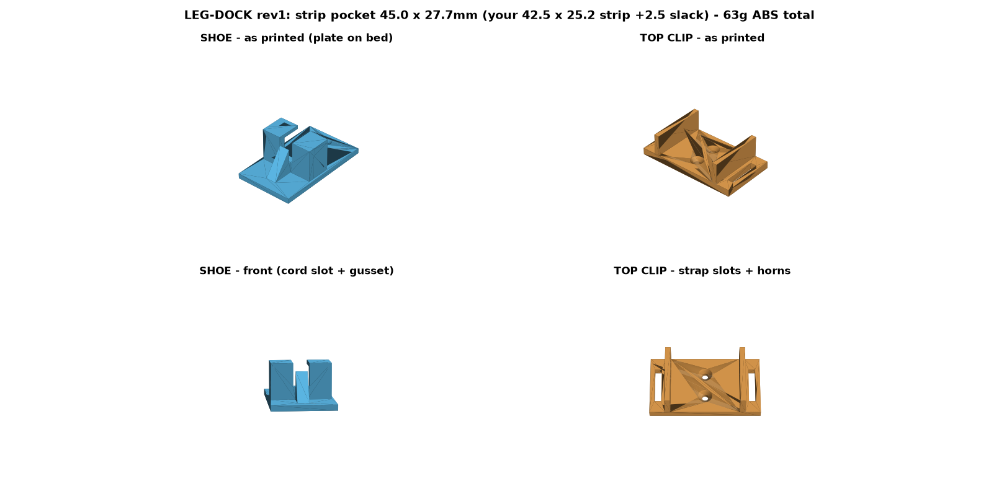
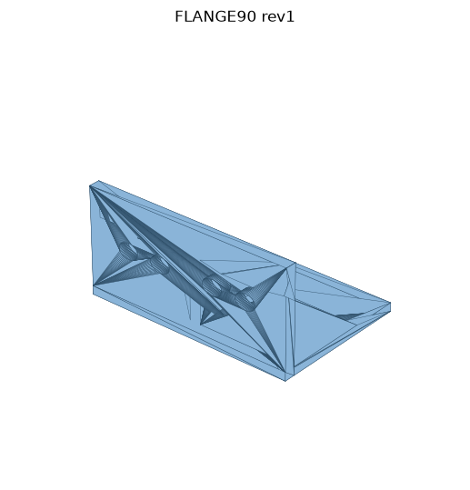
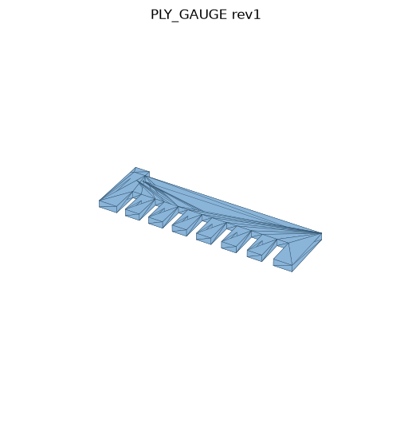

# 3D-printed parts that fit real things

By Brandon Warrell, graphic designer in Sarasota–Bradenton, FL. Portfolio: [brandonwarrell.com](https://www.brandonwarrell.com)

Small functional parts for my house, each one generated by a Python script from measurements I took with calipers. Change a number at the top of the script, run it, and you get a new STL.

**Printer:** Flashforge Adventurer 3 (150 × 150 × 150 mm build volume). Nothing here is bigger than about 145 mm.
**Materials:** ABS for final parts (the printer is enclosed and the rooms run hot), PLA for quick fit tests and shop tools.

## The parts

### `tub-drain/`: PLUG47, a plug disc for a tub fitting

- **Measured:** the fitting's inner ring is **47.50 mm** (calipers).
- **Designed:** a 47.20 mm disc, 5.00 mm tall. That leaves 0.30 mm of slip clearance across the diameter. The bottom edge has a 0.40 mm chamfer so it starts into the hole easily and the first layer's "elephant's foot" doesn't make it too big.
- **Built as:** a convex hull of three rings of points, so the shape is exact with no boolean operations.
- **Fit result:** waiting on the first test print.

### `under-desk/`: LEG-DOCK, a power-strip dock for a desk leg

- **Measured:** I scanned the area under my desk with RealityScan to see where the cables and the legs were. Then I measured the power strip itself with calipers: **42.5 × 25.2 mm**.
- **Designed:** two parts. A SHOE with a 45.0 × 27.7 mm pocket screws to the 95 × 95 mm back leg and carries the strip's weight, with a slot for the cord. A CLIP higher up takes a velcro strap so the strip can't tip out.
- **Also here:** KEY-GAUGE, a sprue of six numbered test studs I made to check a keyhole-mount idea. I dropped that approach for the dock.
- **Fit result:** waiting on the first test print.



### `pup-stairs/`: parts for a plywood dog staircase

My dog is a senior poodle/golden mix and the bed is 31 in high. The stairs are 1/4 in plywood boxes joined with hot glue. Hot glue holds well in shear and poorly in peel, so the design keeps every glue joint in shear.

- **FLANGE-90:** a corner bracket with eight 6 mm holes. Hot glue pressed through the holes hardens into rivets, so a weak butt joint becomes a big shear joint.
- **PLY-GAUGE:** a comb with seven slots from 5.0 to 6.2 mm. The slot that slides snug onto the plywood edge tells you the panel's real thickness, which is rarely the label size.
- **Status:** waiting on the glue-joint break test.




## How the scripts work

- Built with **numpy** and **trimesh**, with the **manifold3d** engine for boolean unions and cuts.
- Every key dimension is a named constant at the top of the file, with a comment saying where the number came from.
- After export, each script **reloads the STL from disk** and checks it, for example that it's watertight and comes out at the intended size. A part that fails a check doesn't ship.
- Each STL has a README next to it with print notes and the questions a test print should answer.

```bash
pip install numpy trimesh manifold3d
python tub-drain/generator.py
python pup-stairs/generator.py ALL        # or PLY_GAUGE / FLANGE_90
python under-desk/generator.py            # PART is set at the top of the file
```

## Measure first, then print a gauge

Scans are good for layout, but they're off by a few millimeters on dark or shiny edges. For anything that has to fit, I trust calipers. When even calipers can't answer the question (how tight is tight enough on my printer?), I print a small gauge or test piece first and let it tell me.

## Credits

I wrote these generators with help from an AI coding assistant (Claude). The measurements are mine.
